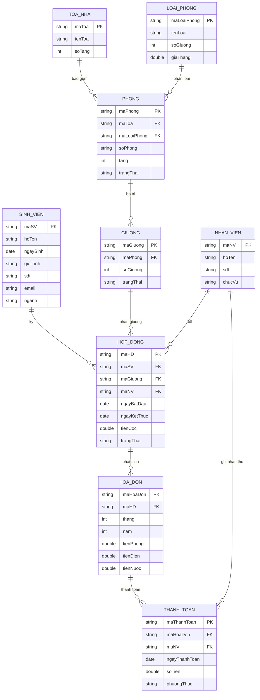

# Đặc tả dự án: Dorm Management System (MIS)

**Môn học:** Lập trình hướng đối tượng
**Nhóm:** 36

|STT|Họ tên|MSSV|
|-|-|-|
|1|Đoàn Thanh Kiều|25162067|
|2|Nguyễn Thị Ngọc Nhung|25162089|
|3|Nguyễn Phước Lộc|25162077|


## 1\. Phát biểu vấn đề

Hệ thống quản lý ký túc xá hỗ trợ ban quản lý theo dõi **tòa nhà**, **phòng**, **loại phòng**, **giường**, **sinh viên nội trú**, **hợp đồng**, **hóa đơn** và **thanh toán**.

Mỗi tòa nhà gồm nhiều phòng, mỗi phòng thuộc một loại phòng và được bố trí nhiều giường. Sinh viên ký hợp đồng để ở một giường trong một khoảng thời gian, do một nhân viên lập. Từ mỗi hợp đồng, hệ thống phát sinh các hóa đơn hằng tháng; mỗi hóa đơn có thể được thanh toán một hoặc nhiều lần và do nhân viên ghi nhận thu.

Hệ thống giúp:

* Kiểm tra giường và phòng còn trống.
* Theo dõi hợp đồng, hóa đơn và công nợ của sinh viên.
* Lưu lịch sử cư trú qua hợp đồng.
* Thống kê tình hình sử dụng phòng và doanh thu.

**Quy tắc nghiệp vụ:** không cho phép trùng thời gian cư trú của cùng một sinh viên hoặc cùng một giường.


## 2\. Thực thể và thuộc tính

|STT|Thực thể|Thuộc tính khóa|Thuộc tính mô tả|
|-|-|-|-|
|1|**ToaNha** (Tòa nhà)|`maToa`|tenToa, soTang|
|2|**Phong** (Phòng)|`maPhong`|soPhong, tang, trangThai|
|3|**LoaiPhong** (Loại phòng)|`maLoaiPhong`|tenLoai, soGiuong, giaThang|
|4|**SinhVien** (Sinh viên)|`maSV`|hoTen, ngaySinh, gioiTinh, sdt, email, nganh|
|5|**HopDong** (Hợp đồng)|`maHD`|ngayBatDau, ngayKetThuc, tienCoc, trangThai|
|6|**Giuong** (Giường)|`maGiuong`|soGiuong, trangThai|
|7|**NhanVien** (Nhân viên)|`maNV`|hoTen, sdt, chucVu|
|8|**HoaDon** (Hóa đơn)|`maHoaDon`|thang, nam, tienPhong, tienDien, tienNuoc|
|9|**ThanhToan** (Thanh toán)|`maThanhToan`|ngayThanhToan, soTien, phuongThuc|

> Ghi chú: tổng tiền hóa đơn là thuộc tính suy diễn (`tienPhong + tienDien + tienNuoc`), tính trong phương thức `getTongTien()`. Trạng thái đã trả hay chưa trả của hóa đơn được suy ra từ tổng các khoản thanh toán.


## 3\. Mối liên kết

|Liên kết|Thực thể 1|Bản số|Thực thể 2|Giải thích|
|-|-|-|-|-|
|Bao gồm|ToaNha|1 – N|Phong|Một tòa có nhiều phòng|
|Phân loại|LoaiPhong|1 – N|Phong|Một loại phòng áp dụng cho nhiều phòng|
|Bố trí|Phong|1 – N|Giuong|Một phòng có nhiều giường|
|Ký|SinhVien|1 – N|HopDong|Một sinh viên có thể ký nhiều hợp đồng theo thời gian|
|Phân giường|Giuong|1 – N|HopDong|Một giường có nhiều hợp đồng theo thời gian|
|Lập|NhanVien|1 – N|HopDong|Một nhân viên lập nhiều hợp đồng|
|Phát sinh|HopDong|1 – N|HoaDon|Một hợp đồng phát sinh nhiều hóa đơn|
|Thanh toán|HoaDon|1 – N|ThanhToan|Một hóa đơn có thể được trả nhiều lần|
|Ghi nhận thu|NhanVien|1 – N|ThanhToan|Một nhân viên ghi nhận nhiều khoản thu|


## 4\. ERD




## 5\. Enum

|Enum|Giá trị|Dùng cho|
|-|-|-|
|`GioiTinh`|NAM, NU|SinhVien|
|`TrangThaiPhong`|CON_CHO, DAY, DANG_SUA_CHUA|Phong|
|`TrangThaiGiuong`|TRONG, DA_CO_NGUOI|Giuong|
|`TrangThaiHopDong`|HIEU_LUC, HET_HAN, DA_HUY|HopDong|
|`PhuongThucThanhToan`|TIEN_MAT, CHUYEN_KHOAN, VI_DIEN_TU|ThanhToan|
|`ChucVu`|QUAN_LY, KE_TOAN, LE_TAN|NhanVien|


## 6\. Thiết kế lớp Java (dự kiến)

Cấu trúc package:

```
src/
├── model/    (ToaNha, Phong, LoaiPhong, Giuong, SinhVien, HopDong, NhanVien, HoaDon, ThanhToan)
├── enums/    (GioiTinh, TrangThaiPhong, TrangThaiGiuong, TrangThaiHopDong, PhuongThucThanhToan, ChucVu)
├── data/     (DataGenerator)
├── dao/      (IGenericDAO, BaseDAO, 9 DAO, DormContext)
├── query/    (KieuQueries, NhungQueries, LocQueries)
├── Main.java        (chạy cả 30 câu)
├── MainQuery.java   (10 câu của Kiều)
├── MainQuery2.java  (20 câu của Nhung và Lộc)
├── MainDao.java     (kiểm tra DAO)
└── MainModel.java   (kiểm tra model)
```

Quy tắc chuyển ERD sang class:

* Mỗi thực thể là một class; thuộc tính là field `private` kèm constructor, getter, setter.
* Quan hệ 1-N: phía "1" chứa `List<ClassN>`, phía "N" chứa một tham chiếu về phía "1".
* Các trường ngày tháng dùng `LocalDate`.
* Kiểm tra quy tắc không trùng thời gian cư trú khi tạo hợp đồng.

Ví dụ rút gọn:

```java
public class ToaNha {
    private String maToa;
    private String tenToa;
    private int soTang;
    private List<Phong> danhSachPhong = new ArrayList<>();
}

public class Phong {
    private String maPhong;
    private String soPhong;
    private int tang;
    private TrangThaiPhong trangThai;
    private ToaNha toaNha;
    private LoaiPhong loaiPhong;
    private List<Giuong> danhSachGiuong = new ArrayList<>();
}

public class HopDong {
    private String maHD;
    private LocalDate ngayBatDau;
    private LocalDate ngayKetThuc;
    private double tienCoc;
    private TrangThaiHopDong trangThai;
    private SinhVien sinhVien;
    private Giuong giuong;
    private NhanVien nhanVienLap;
    private List<HoaDon> danhSachHoaDon = new ArrayList<>();
}

public class HoaDon {
    private String maHoaDon;
    private int thang;
    private int nam;
    private double tienPhong;
    private double tienDien;
    private double tienNuoc;
    private HopDong hopDong;
    private List<ThanhToan> danhSachThanhToan = new ArrayList<>();

    public double getTongTien() {
        return tienPhong + tienDien + tienNuoc;
    }
}
```


## 7. Kế hoạch dữ liệu mẫu

Dữ liệu được sinh trong bộ nhớ bởi `DataGenerator`, mã sinh theo thứ tự cố định để bản Java và C# cho kết quả giống nhau.

| Thực thể | Số lượng | Mã | Ghi chú |
|-|-|-|-|
| ToaNha | 3 | T01 – T03 | Tòa A, B, C |
| LoaiPhong | 3 | LP01 – LP03 | Phòng 4, 6, 8 giường |
| Phong | 10 | P01 – P10 | P10 ở trạng thái `DANG_SUA_CHUA` |
| Giuong | 52 | G01 – G52 | 31 giường trống, 21 giường có người |
| SinhVien | 24 | SV01 – SV24 | 12 nam, 12 nữ, 6 ngành (mỗi ngành 4 sinh viên) |
| NhanVien | 4 | NV01 – NV04 | 1 quản lý, 1 kế toán, 2 lễ tân |
| HopDong | 31 | HD01 – HD31 | 21 hiệu lực, 8 hết hạn, 2 đã hủy |
| HoaDon | 46 | HDN01 – HDN46 | 4 hóa đơn của hợp đồng cũ, 42 hóa đơn tháng 9 và 10/2026 |
| ThanhToan | 46 | TT01 – TT46 | Có trả đủ, trả một phần, trả nhiều lần |

Các tình huống đặc biệt được dựng sẵn để truy vấn có kết quả:

| Tình huống | Số lượng / ví dụ |
|-|-|
| Hợp đồng sắp hết hạn trong 30 ngày | 3 (HD13, HD20, HD27), tính theo ngày chạy |
| Hóa đơn chưa trả / trả một phần / trả đủ | 10 / 11 / 25 |
| Phòng còn đúng 1 giường trống | 2 (P02, P08) |
| Sinh viên từng ở nhiều hơn một giường | 6 (SV01 ở 3 giường, SV02 – SV06 ở 2 giường) |
| Hợp đồng đã hủy | 2 (HD30, HD31) |
| Phòng đang sửa chữa | 1 (P10) |
| Sinh viên chưa có hợp đồng | 1 (SV24) |

Quy tắc nghiệp vụ "không trùng thời gian cư trú" được kiểm tra ngay khi tạo hợp đồng trong `DataGenerator` (hợp đồng đã hủy không tính).


## 8\. Danh sách câu truy vấn (chưa code)

### Thành viên 1: Đoàn Thanh Kiều

1. Liệt kê các giường còn trống trong tòa nhà A.
2. Tìm tất cả sinh viên đang ở trong một phòng cụ thể.
3. Liệt kê các hợp đồng sẽ hết hạn trong 30 ngày tới.
4. Tính tổng doanh thu đã thu theo từng tháng của một năm.
5. Liệt kê sinh viên có hóa đơn chưa thanh toán đủ.
6. Tìm tòa nhà có tỷ lệ lấp đầy giường cao nhất.
7. Thống kê số sinh viên theo ngành học.
8. Thống kê số phòng theo từng loại phòng.
9. Tìm sinh viên đã từng ở nhiều hơn một giường.
10. Tìm nhân viên ghi nhận tổng số tiền thu nhiều nhất.

### Thành viên 2: Nguyễn Thị Ngọc Nhung

1. Liệt kê toàn bộ các phòng còn chỗ trống (còn ít nhất 1 giường trống) trong ký túc xá.
2. Tìm kiếm thông tin chi tiết của sinh viên dựa theo mã sinh viên hoặc họ tên.
3. Tính tổng tiền điện, nước và tiền phòng phải thu của một phòng cụ thể trong tháng.
4. Thống kê số hóa đơn theo tình trạng: đã trả đủ / trả một phần / chưa trả.
5. Thống kê doanh thu tổng từ tiền phòng và dịch vụ của toàn ký túc xá theo từng quý.
6. Tìm sinh viên đang ở giường có mã số cụ thể và xem thông tin liên hệ của họ.
7. Lọc ra danh sách các phòng có trangThai = CON_CHO
8. Liệt kê toàn bộ danh sách các hợp đồng thuê phòng đã được lập.
9. Lọc ra danh sách các hóa đơn có trạng thái "Chưa thanh toán".
10. Tìm 3 phòng có tổng tiền điện cao nhất.

### Thành viên 3: Nguyễn Phước Lộc

1. Liệt kê các phòng theo một tầng cụ thể trong một tòa nhà.
2. Liệt kê các hợp đồng đã bị hủy 
3. Tìm sinh viên có nhiều hợp đồng nhất (ở lâu/thuê nhiều lần nhất). 
4. Liệt kê các phòng đang ở trạng thái "Đang sửa chữa" 
5. So sánh tổng doanh thu giữa các tòa nhà trong cùng một năm. 
6. Thống kê số lượng hợp đồng do mỗi nhân viên lập, sắp xếp giảm dần. 
7. Liệt kê danh sách nhân viên theo từng chức vụ (QUAN_LY, KE_TOAN, LE_TAN). 
8. Liệt kê các phòng chỉ còn đúng 1 giường trống (sắp đầy chỗ, cần ưu tiên xếp sinh viên mới). 
9. Thống kê số lượng sinh viên theo giới tính (Nam/Nữ) trong toàn ký túc xá.
10. Tính thời gian cư trú trung bình (số ngày) của các hợp đồng đã kết thúc.


## 9. Công nghệ và phân công

| Hạng mục | Java | C# |
|---|---|---|
| Truy vấn | Lambdas / Stream API | LINQ |
| Dữ liệu | DataGenerator (in-memory) | DataGenerator (in-memory) |
| Ngày tháng | LocalDate | DateTime |

| Thành viên | Phụ trách chung | Truy vấn |
|---|---|---|
| Đoàn Thanh Kiều | Model, enums, DataGenerator (Java) | 10 câu (Stream + LINQ) |
| Nguyễn Phước Lộc | Port toàn bộ sang C# | 10 câu (Stream + LINQ) |
| Nguyễn Thị Ngọc Nhung | Báo cáo Word, video | 10 câu (Stream + LINQ) |


## 9. Cách chạy (Java)

1. Mở thư mục `DormManagement` bằng IntelliJ IDEA, chọn JDK 17 trở lên.
2. Đánh dấu thư mục `src` là Sources Root (nếu IntelliJ chưa tự nhận).
3. Chạy `Main.java` để in kết quả cả 30 câu truy vấn.
4. Nếu tiếng Việt bị lỗi font: Run → Edit Configurations → VM options → `-Dfile.encoding=UTF-8`.

Dữ liệu mẫu sinh trong bộ nhớ bởi `DataGenerator`, không cần cài cơ sở dữ liệu.
Câu "hợp đồng sắp hết hạn" tính theo ngày hiện tại nên luôn ra 3 kết quả.

